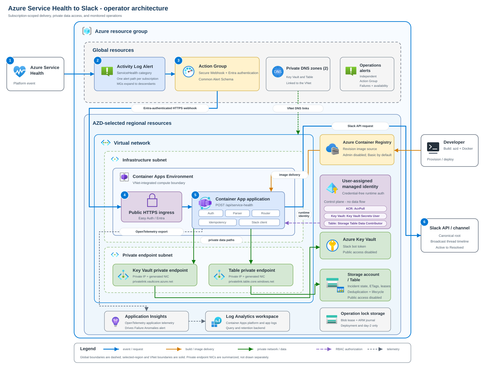

# Design and security reference

## Architecture

The deployment uses Azure Container Apps, Azure Container Registry, a
user-assigned managed identity, Key Vault, an application Azure Table Storage
account, an isolated Blob Storage operation lock, Log Analytics, and
workspace-based Application Insights.

Azure Monitor matches Service Health events in a subscription Activity Log and
sends the Common Alert Schema payload to the public Container Apps endpoint.
Container Apps authentication validates the Microsoft Entra token. The
application then verifies the Azure Monitor caller application, token audience,
and `ActionGroupsSecureWebhook` app role before parsing the payload.

Key Vault and Table Storage have public network access disabled. The Container
Apps environment reaches both services through private endpoints and private
DNS. The webhook and health probes still use the Container App's public HTTPS
ingress.

The diagram is an example deployment in East US 2. All regional resources use
the AZD location selected during provisioning. The Activity Log Alert, Action
Group, and private DNS zones use the Azure `Global` location.

### Main resources

| Resource | Purpose |
|---|---|
| Container App | Runs the Flask service with public HTTPS ingress, one to three replicas, and single revision mode. |
| Container Apps environment | Provides the VNet-integrated compute boundary and sends platform logs to Log Analytics. |
| Action Group | Sends a Microsoft Entra authenticated Secure Webhook request using Common Alert Schema. |
| Activity Log Alert | Matches `category = ServiceHealth` for one subscription. |
| User-assigned managed identity | Pulls the image and accesses Key Vault and Table Storage without application credentials. |
| Key Vault | Stores the Slack bot token and exposes the latest enabled version to Container Apps through a versionless reference. |
| Application Storage account and table | Stores incident state, Slack timestamps, ETags, and processing leases. |
| Isolated operation-lock Storage account and blob container | Serializes deployment and day-2 operations without mixing lock metadata with application data. |
| Private endpoints and DNS zones | Provide private Key Vault and Table Storage data paths. |
| Container Registry | Stores the application image. Registry admin access and anonymous pull are disabled. |
| Application Insights and Log Analytics | Receive application telemetry, Container Apps logs, and Key Vault/Table diagnostics. |

An independent operations Action Group receives webhook, dependency,
availability, and replica alerts. It must not depend only on this Slack bot.

## HTTP routes

| Route | Access | Purpose |
|---|---|---|
| `POST /api/service-health` | Microsoft Entra token plus application checks | Receives Common Alert Schema notifications. |
| `GET /healthz` | Public | Reports process liveness. |
| `GET /readyz` | Public | Confirms required configuration and client construction. |

`/readyz` does not perform a Table Storage transaction. Use an accepted test
notification and Application Insights dependency telemetry to verify managed
identity, private DNS, and Table data-plane access.

## Service Health payload mapping

Azure Monitor places common fields in `data.essentials` and the Activity Log
event in `data.alertContext`. This service requires:

- `schemaId = azureMonitorCommonAlertSchema`
- `alertContext.eventSource = ServiceHealth`
- a subscription ID in `alertContext.subscriptionId`, `essentials.alertId`, or
  `essentials.alertTargetIDs`
- `properties.trackingId`, `title`, `communication`, `impactStartTime`, and
  `impactedServices`
- `alertContext.level`
- `submissionTimestamp` or `eventTimestamp`

Microsoft documents `properties.impactedServices` as an escaped JSON string.
The parser also accepts an already-decoded list for compatibility. Each service
contains `ServiceName` and `ImpactedRegions`, whose entries contain
`RegionName`.

Microsoft documents Activity Log status values such as `Active` and `Resolved`,
with additional stage values that depend on the incident type. `Updated` in
this application is a local lifecycle label: a newer accepted nonterminal
notification for an existing Slack incident is rendered as an update. It is
not presented as a complete list of Azure Service Health stage values.
For Maintenance events, `Planned` maps to `Active`; `InProgress` and
`Rescheduled` map to `Updated`; and `Complete`, `Canceled`, `Cancelled`, and
`Resolved` map to `Resolved`. `RCA` is also rendered as resolved because it is
a post-resolution communication.
Slack renders `Active` with a red circle, `Updated` with an orange circle, and
`Resolved` with a green circle. The Slack app avatar is separate from this
lifecycle indicator.

See the official [Common Alert Schema](https://learn.microsoft.com/azure/azure-monitor/alerts/alerts-common-schema)
and [Service Health event properties](https://learn.microsoft.com/azure/service-health/service-health-event-properties).

## Routing

Set either `SERVICE_HEALTH_ROUTES_JSON` or
`SERVICE_HEALTH_ROUTES_FILE`. The example is
`config/service_health_routes.example.json`.

`default_channel_id` is required. Rules can filter by `subscription_ids`,
`services`, and `regions`. Every filter supplied by a rule must match. The
highest priority wins, followed by the most specific rule and then file order.
The first selected channel is stored with the incident and remains fixed for
that incident.

Use Slack channel IDs, not names. The bot must be a member of every destination
channel unless you grant the broader `chat:write.public` scope. This guide uses
only `chat:write` and explicit channel membership.

## Idempotency and lifecycle

The Table entity key is the normalized subscription ID plus a SHA-256 hash of
the tracking ID. ETags and a 30-second lease coordinate concurrent replicas.

The first accepted notification calls `chat.postMessage`. Each newer accepted
notification updates the root with `chat.update`, checkpoints the root state,
and posts a broadcast thread reply. Identical notifications and notifications
at or below the stored submission watermark return `200` without calling Slack.

Transient Slack or Storage failures return `503`, which is one of the status
codes Azure Monitor treats as retryable for webhooks. Invalid payloads and
permanent Slack errors return a nonretryable `4xx`.

## Security model

### Webhook authentication

The Action Group uses Secure Webhook authentication. The preprovision hook:

1. Creates or loads the protected API app registration by persisted object and
   client IDs.
2. Configures Microsoft Entra v2 access tokens and the
   `api://<client-id>` identifier URI.
3. Creates an application-only `ActionGroupsSecureWebhook` app role.
4. Ensures service principals exist for the API and the official Azure Monitor
   AzNS AAD Webhook application
   (`461e8683-5575-4561-ac7f-899cc907d62a`).
5. Adds the deployment caller and AzNS service principal as verified owners.
6. Assigns the app role to the AzNS service principal.

The official Secure Webhook procedure requires the Microsoft Entra
`Application Administrator` role to configure this relationship. This is a
deployment-time role, not a runtime permission.

Container Apps authentication accepts the API client ID and its identifier URI
as audiences and restricts the authenticated application to AzNS. The Flask
application independently checks the caller application claim, audience, and
app role from the Easy Auth principal header.

`globalValidation.unauthenticatedClientAction` is `AllowAnonymous` so the public
health probes work. The Flask webhook route returns `401` when the Easy Auth
principal is absent and `403` when its claims do not meet the application
policy.

### Managed identity and RBAC

The deployment creates these direct role assignments for one user-assigned
managed identity:

| Scope | Role | Use |
|---|---|---|
| Container Registry | `AcrPull` | Pull the application image. |
| Key Vault | `Key Vault Secrets User` | Resolve the Slack token reference. |
| Application Storage account | `Storage Table Data Contributor` | Read and write incident entities. |

The application uses `ManagedIdentityCredential` with `AZURE_CLIENT_ID` in
production and staging. It uses `DefaultAzureCredential` for local development.
Storage shared-key access is disabled.

### Network boundaries

Key Vault and Storage set `publicNetworkAccess` to `Disabled`. Each service has
a private endpoint and private DNS zone linked to the Container Apps VNet. The
Container Registry and Application Insights ingestion endpoints remain public
Azure endpoints.

When bootstrap runs outside the VNet, the secret lifecycle CLI opens only a
default-deny operator IPv4 `/32`, grants a temporary vault-scoped secret role,
writes through the Key Vault data plane, and restores both controls before
workload provisioning. An approved private operator path skips this temporary
window.

The Bicep private DNS suffixes and the documented Service Health Secure Webhook
flow target Azure public cloud. Do not assume this template works unchanged in
a sovereign cloud.

## Known limits

- There is a crash window after Slack accepts a write and before Table Storage
  records its timestamp. An initial post can leave an untracked root, and a
  thread reply can be duplicated on replay.
- Slack does not provide a downstream idempotency key for these message calls,
  so the service cannot guarantee exactly-once delivery across Slack and Table
  Storage.
- Normal deployments use a versionless Key Vault secret URI. The secret
  lifecycle CLI validates a replacement before writing a new version and can
  temporarily pin a captured prior version for emergency rollback.
- New environments use an infrastructure-only provision followed by one hidden
  Key Vault data-plane transfer. The token is removed from local AZD state
  before workload provisioning; later preview, provision, routing, and rollback
  operations are token-free.
- The day-2 command implements a Management Group as one managed subscription
  alert path per accessible descendant. It does not deploy one native
  Management Group Activity Log Alert.
- The Tenant Root Group contains every subscription and Management Group in the
  tenant. A day-2 Management Group operation that includes the central
  subscription is rejected because it overlaps the immutable AZD-owned baseline
  alert. Use a non-overlapping child Management Group or manage additional
  subscriptions individually.
- The webhook reads at most the configured payload limit plus one byte, including
  chunked requests without `Content-Length`; the default accepted payload limit
  is 256 KiB.
- Azure Table string properties retain at most 32,000 UTF-16 code units. Slack
  rendering has its own smaller display limits, while correlation fingerprints
  continue to use the complete accepted event.
- The templates use Azure public cloud endpoint suffixes.
